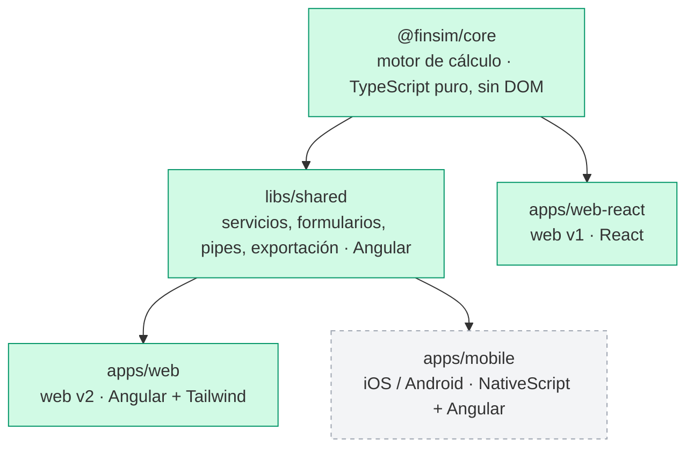

# FinSim — Simulador Financiero

[](https://github.com/etenorio87/finsim/actions/workflows/ci.yml)
[](https://github.com/etenorio87/finsim/actions/workflows/deploy.yml)

Herramienta de decisión para evaluar financiaciones con el móvil en la mano. Calcula el **precio real del dinero (TAE)**, compara ofertas y ayuda a decidir entre financiar o pagar al contado.

🔗 **Demo en vivo**: https://etenorio87.github.io/finsim/

## Propósito

Responder, en una tienda y en segundos, a cuatro preguntas:

1. **¿Cuánto me cuesta realmente esta financiación?** TAE real, coste total, cuadro de amortización
2. **¿Cuál de estas dos ofertas es mejor?** Comparación por TAE, no por cuota
3. **¿Me conviene financiar o pagar al contado?** Si tengo el dinero rindiendo
4. **¿Cuánto ahorro si amortizo anticipadamente?** Reducir cuota frente a reducir plazo

No es una calculadora genérica de préstamos: es una herramienta que **protege al usuario del sesgo comercial** de comparar solo las cuotas mensuales.

## Estado del proyecto

FinSim está **migrando de una web React a una plataforma Angular multiplataforma**: un único motor de cálculo compartido por una web y una app móvil nativa.

| Componente | Tecnología | Estado |
|---|---|---|
| Motor de cálculo `@finsim/core` | TypeScript puro | ✅ Estable, 37 tests |
| Web v1 `@finsim/web-react` | React 19 | ✅ En producción, se sustituirá por la web Angular |
| Capa compartida `@finsim/shared` | Angular 22 | ✅ Lista, 45 tests; la usarán las apps Angular |
| Web v2 `@finsim/web` | Angular 22 + Tailwind v4 | ✅ Completa, 8 tests; se publicará en la Fase 3 |
| App móvil `apps/mobile` | NativeScript + Angular | 📋 Planificada |

La versión React original queda etiquetada como [`v1-react`](https://github.com/etenorio87/finsim/tree/v1-react).

## Arquitectura



- **`@finsim/core`** concentra toda la lógica financiera. No depende de ningún framework ni del navegador; se comprueba compilándolo sin la librería DOM.
- **`@finsim/shared`** comparte entre web y móvil todo lo que no es una plantilla: estado con signals, formularios y validadores, el campo decimal, pipes y generación de exportaciones. Tampoco depende del navegador: sus tests se ejecutan en Node. Guía de uso en [libs/shared/README.md](libs/shared/README.md).
- Cada aplicación aporta **solo sus vistas**: HTML + Tailwind en la web y elementos nativos en el móvil.

## Principios de diseño

- **Tipos en decimal dentro del dominio.** Se guarda `0.0545`, no `5.45`; el formato `"5,45 %"` solo existe en la presentación. Mezclar ambas representaciones produce errores que no fallan: devuelven números plausibles pero incorrectos.
- **Nada se persiste.** El cuadro de amortización se deriva siempre de las condiciones, así nunca hay un cuadro que no les corresponda.
- **TAE real, comisiones incluidas.** Se calcula por búsqueda iterativa y se valida contra documentos reales (BBVA, Cetelem).
- **Jerarquía visual intencionada.** TAE grande, cuota mediana, coste total pequeño: la cuota baja es el argumento comercial y la TAE es el precio.

El contrato completo está en [ESPECIFICACION.md](ESPECIFICACION.md).

## Funcionalidades

- **Simular financiación**: TAE, cuota, coste total, saldo medio y cuadro de amortización exportable a Excel y PDF
- **Comparar ofertas**: ganadora por TAE, con aviso cuando los plazos difieren ("Dinero más barato" en lugar de "Mejor oferta")
- **¿Financiar o contado?**: compara la TAE con la rentabilidad neta de impuestos de tu inversión
- **Amortización parcial**: reducir cuota frente a reducir plazo, con cuadro de ahorros y comparación antes/después
- **Entrada pensada para móvil**: acepta coma y punto decimales; texto libre al escribir y formato al salir del campo

Casos de uso paso a paso en [USAGE.md](USAGE.md).

## Tecnologías

| Área | Actual | Prevista |
|---|---|---|
| Monorepo | Nx + npm workspaces | — |
| Lenguaje | TypeScript 6.0 | — |
| Capa compartida | Angular 22 (signals, Reactive Forms) | — |
| Web | React 19, Vite, Tailwind CSS v4 | Angular 22, Tailwind CSS v4 |
| Móvil | — | NativeScript 9 + Angular 22 (iOS y Android) |
| Exportación | SheetJS (`xlsx`), jsPDF | — |
| Tests | Vitest | — |
| CI/CD | GitHub Actions, GitHub Pages | Builds de iOS y Android |

## Desarrollo

Requisitos: Node.js 20.19+ (recomendado 24).

```bash
npm install          # instalar dependencias (desde la raíz)
npm run dev          # web React (en producción) → http://localhost:5173/finsim/
npm run dev:web      # web Angular → http://localhost:4200/
npm test             # tests de todos los proyectos (con caché de Nx)
npm run typecheck    # comprobación de tipos
npm run build        # build de todos los proyectos
npm run ejemplo      # ejemplo del motor por consola

# Tareas de un proyecto concreto
npx nx run @finsim/core:test
npx nx run @finsim/shared:test
npx nx run @finsim/web:build
npx nx run @finsim/web-react:build
```

## Estructura

```
finsim/
├── libs/
│   ├── core/                    # @finsim/core — motor de cálculo
│       └── src/
│           ├── index.ts             # API pública
│           ├── types.ts             # Contrato del dominio
│           ├── motor.ts             # Cuota, cuadro y TAE
│           ├── amortizacion.ts      # Primitivas de amortización francesa
│           ├── comparadores.ts      # Oferta A vs B, financiar vs contado
│           ├── amortizacionParcial.ts
│           ├── formato.ts           # Parseo y formato compartidos por las interfaces
│           └── *.test.ts
│   └── shared/                  # @finsim/shared — capa de presentación Angular (sin DOM)
│       └── src/lib/
│           ├── estado/              # Stores con signals, uno por pantalla
│           ├── formularios/         # FormGroups tipados y validadores
│           ├── campo-decimal/       # ControlValueAccessor base del campo numérico
│           ├── pipes/               # moneda, porcentaje
│           ├── exportacion/         # Excel/PDF como bytes + destino por plataforma
│           └── textos/              # Etiquetas y mensajes
├── apps/
│   ├── web/                     # @finsim/web — web v2 (Angular), pendiente de publicar
│   │   └── src/app/
│   │       ├── paginas/             # simulador, comparador, contado, amortización parcial
│   │       ├── ui/                  # campo decimal, formulario de condiciones, tarjeta de resultado
│   │       └── plataforma/          # descarga de archivos en el navegador
│   └── web-react/               # @finsim/web-react — web v1 en producción
├── .github/workflows/
│   ├── ci.yml                   # test + typecheck + build en cada PR
│   └── deploy.yml               # despliegue a GitHub Pages
└── nx.json
```

## Hoja de ruta de la migración

- [x] **Fase 0** — Monorepo Nx y extracción de `@finsim/core`
- [x] **Fase 1** — `libs/shared`: estado, formularios, pipes y exportación en Angular
- [x] **Fase 2** — `apps/web`: web Angular con las cuatro funcionalidades
- [ ] **Fase 3** — Verificación de paridad con la web React y cambio del despliegue
- [ ] **Fase 4** — Prueba técnica de NativeScript (exportación y compartir archivos)
- [ ] **Fase 5** — `apps/mobile`: app nativa sobre `libs/shared`
- [ ] **Fase 6** — Pulido: iconos, splash, accesibilidad, pruebas en dispositivos
- [ ] **Fase 7** — Publicación en App Store y Google Play

El historial de cambios de la v1 está en [CHANGELOG.md](CHANGELOG.md).

## Despliegue

- **Producción**: https://etenorio87.github.io/finsim/
- **CI**: cada pull request ejecuta tests, typecheck y build
- **CD**: cada push a `main` que afecte a la web o al motor la despliega en GitHub Pages

## Licencia

MIT
